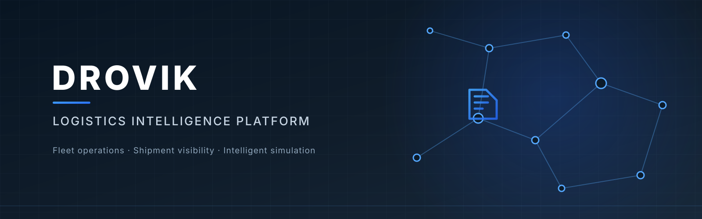
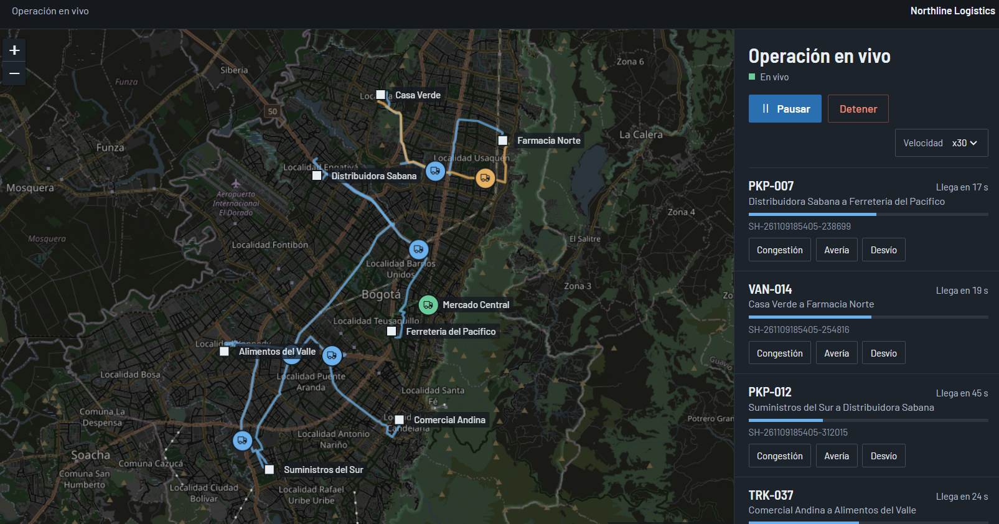
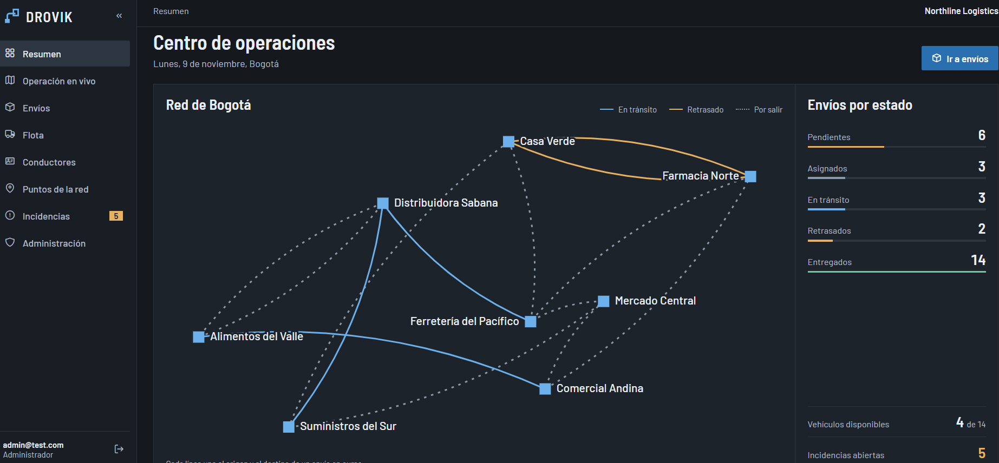
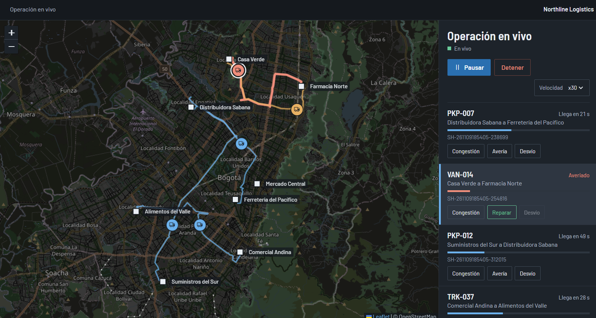
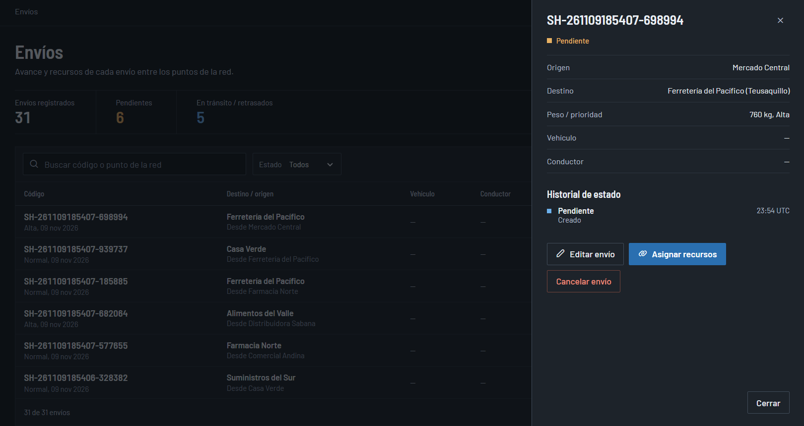
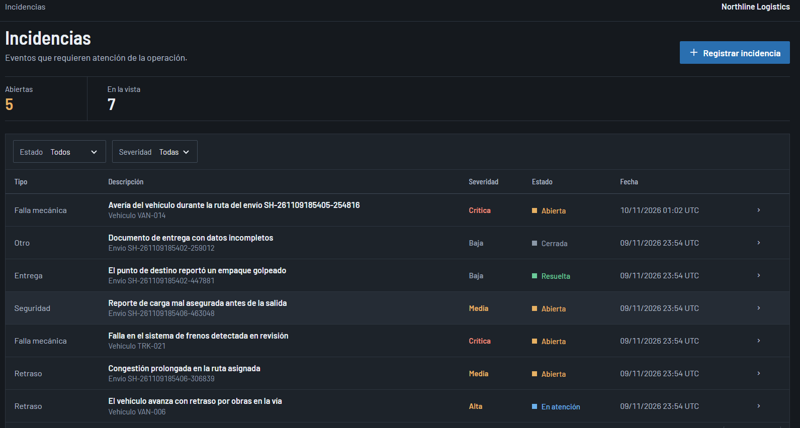
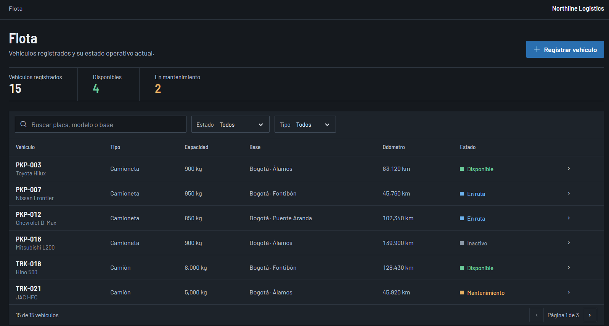
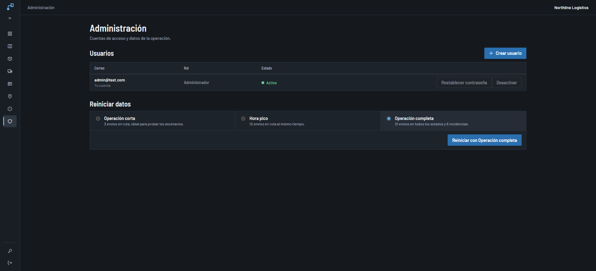
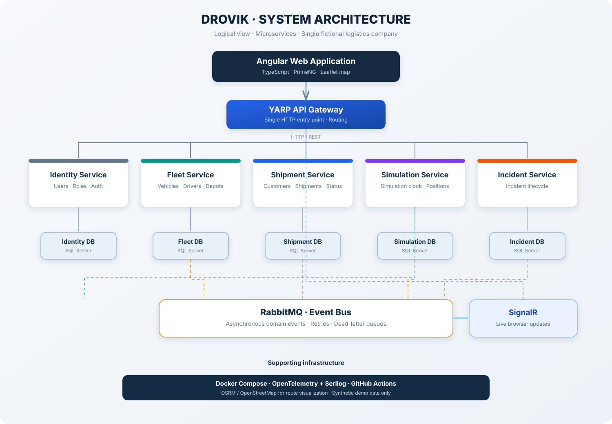

# DROVIK

### Logistics Intelligence Platform

[](https://github.com/JuanGal99/DROVIK/actions/workflows/ci.yml)

<p align="center">
  
</p>

DROVIK es una consola de operaciones logísticas: gestiona flota, conductores y envíos entre 8 puntos de Bogotá, muestra los vehículos moviéndose por calles reales en un mapa en vivo y convierte lo que ocurre en la ruta en incidencias que se pueden atender.

Es un proyecto de portafolio pensado para ejecutarse en local. Empresa, datos, posiciones y eventos son ficticios: no hay GPS ni tráfico real, aunque la consola se presenta como una operación real.

## Qué hace

- **Resumen:** esquema de la red con los envíos en curso, envíos por estado, flota disponible, incidencias abiertas y actividad reciente.
- **Operación en vivo:** mapa con OpenStreetMap, vehículos que avanzan en tiempo real por calles reales, velocidad configurable y controles para iniciar, pausar, reanudar y detener.
- **Escenarios:** por cada vehículo se puede provocar congestión, avería o desvío. Cada uno cambia el recorrido, retrasa el envío cuando corresponde y abre su incidencia.
- **Envíos:** creación entre puntos de la red, reserva de vehículo y conductor, seguimiento de estados e historial. Al llegar a destino se entregan solos y liberan sus recursos.
- **Flota y conductores:** alta, edición, desactivación y reactivación, con validación de capacidad y disponibilidad.
- **Incidencias:** registro, atención, resolución e historial.
- **Administración:** gestión de usuarios y reinicio de datos con semillas, solo para administradores.

## Capturas



| | |
|---|---|
|  |  |
|  |  |
|  |  |

## Arquitectura



Cinco microservicios con base de datos propia (Identity, Fleet, Shipment, Simulation e Incident) detrás de un Gateway YARP. Se comunican por HTTP cuando necesitan respuesta inmediata y por RabbitMQ con Outbox, consumidores idempotentes y colas de error cuando no. La simulación es autoritativa en el servidor y SignalR entrega las posiciones al navegador.

La arquitectura detallada está en [docs/03-architecture.md](docs/03-architecture.md).

## Tecnologías

Angular 21, TypeScript, Leaflet y SignalR en el frontend; ASP.NET Core sobre .NET 10, Entity Framework Core, SQL Server 2022, RabbitMQ 4.4 y YARP en el backend; Docker Compose para la infraestructura y xUnit y Vitest para las pruebas. Las versiones exactas están en [ADR 0007](docs/adr/0007-technical-versions.md).

Los servicios escriben logs JSON con Serilog y generan trazas y métricas con OpenTelemetry; una misma traza sigue una petición desde el Gateway hasta los consumidores de eventos. Para verlas hay un panel opcional, descrito en [operaciones](docs/12-deployment-and-operations.md#126-observabilidad-y-ci). Las pruebas usan xUnit, Vitest y Playwright.

## Ejecución local

Solo necesitas [Docker Desktop](https://www.docker.com/products/docker-desktop/) con Compose v2 en marcha. Clona el repositorio y ejecuta un comando:

En Windows:

```bat
.\start.cmd
```

En macOS, Linux o Git Bash:

```bash
./start.sh
```

La primera vez tarda varios minutos porque compila las imágenes. Al terminar muestra la dirección, [http://localhost:4200](http://localhost:4200), y el correo y la contraseña del administrador. Las contraseñas y claves se generan solas en el archivo local `.env`, que no se sube al repositorio.

Si olvidas una contraseña, un administrador la restablece en Administración. Si no queda ninguno con acceso, sigue [Recuperar el acceso](docs/12-deployment-and-operations.md#recuperar-el-acceso).

Para detener la aplicación:

```bash
docker compose --profile app down
```

Los datos se conservan entre reinicios. Para desarrollar los servicios desde un IDE y ver otras opciones, consulta [la guía de ejecución](docs/12-deployment-and-operations.md).

## Cómo probar una operación

1. Entrar con una cuenta de administrador e ir a **Administración**.
2. En **Reiniciar datos**, elegir una semilla y confirmar:
   - **Operación corta:** 3 envíos en ruta, ideal para probar los escenarios.
   - **Hora pico:** 12 envíos en ruta al mismo tiempo.
   - **Operación completa:** 31 envíos en todos los estados y 6 incidencias.
3. Ir a **Operación en vivo** y pulsar **Iniciar operación**.
4. Usar **Congestión**, **Avería** o **Desvío** en cualquier vehículo y revisar el resultado en **Envíos** e **Incidencias**.

Reiniciar borra los envíos, incidencias y operaciones actuales. Los puntos de la red, la flota y las cuentas se conservan.

## Pruebas

```bash
cd src/backend && dotnet test
```

```bash
cd src/frontend/drovik-web && npm test -- --watch=false
```

## Estado del proyecto

Los módulos descritos arriba están implementados e integrados. Cada cambio en `main` pasa por GitHub Actions: pruebas de backend y frontend, construcción de imágenes y una prueba de navegador sobre la aplicación completa. Queda pendiente la revisión de accesibilidad de la Fase 8. El detalle está en el [estado de implementación](docs/current-implementation-status.md) y en el [roadmap](docs/13-roadmap.md).

## Documentación

- [Visión del producto](docs/01-product-overview.md)
- [Requisitos](docs/02-requirements.md)
- [Arquitectura](docs/03-architecture.md)
- [Límites de servicios](docs/04-service-boundaries.md)
- [Propiedad de datos](docs/05-data-ownership.md)
- [Reglas de negocio](docs/06-domain-and-business-rules.md)
- [Motor de simulación](docs/07-simulation-engine.md)
- [Seguridad](docs/08-security-and-permissions.md)
- [APIs y eventos](docs/09-api-and-events.md)
- [Entorno de datos](docs/10-demo-environment.md)
- [Pruebas](docs/11-testing-strategy.md)
- [Ejecución y operaciones](docs/12-deployment-and-operations.md)
- [Roadmap](docs/13-roadmap.md)
- [Decisiones de arquitectura](docs/adr/)

## Licencia

[MIT](LICENSE).
