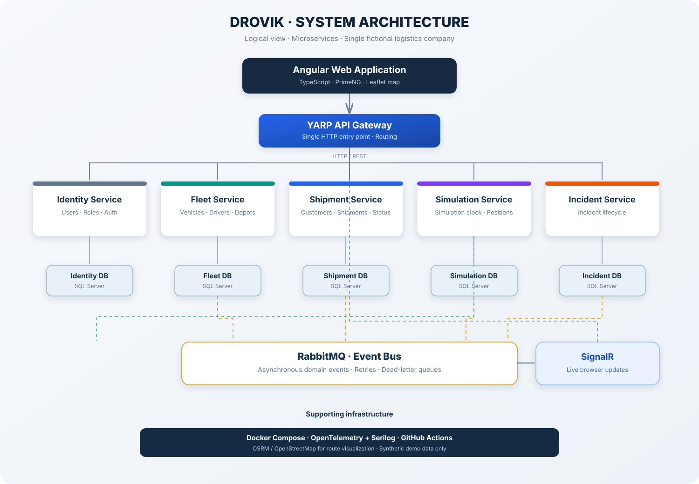

# 3. Arquitectura

## 3.1 Estilo y estado de decisiones

La dirección aprobada es una arquitectura de cinco microservicios con límites de dominio y propiedad de datos independientes. El proyecto se ejecuta localmente; el repositorio público no implica alojamiento público. Ver ADR 0001, 0003 y 0006.

**Aprobado:** Angular + TypeScript + PrimeNG; ASP.NET Core Web API; Identity, Fleet, Shipment, Simulation e Incident; SQL Server y EF Core; YARP; RabbitMQ; SignalR; Docker Compose para infraestructura local; xUnit; OpenTelemetry + Serilog; Leaflet + OpenStreetMap. Redis se omite en la primera versión.

**Versiones fijadas para Fase 1 (2026-11-06):** .NET SDK 10.0.403 / target `net10.0`; EF Core SQL Server 10.0.14; Angular runtime/compiler 21.2.26 y CLI/build 21.2.29; TypeScript 5.9.3; PrimeNG 21.1.10; Node.js 24.11.1 y npm 11.6.2; RxJS 7.8.2; PrimeUIX Themes 3.1.0; PrimeIcons 8.0.2; SQL Server 2022 CU23; RabbitMQ 4.4.0. Angular 21 se selecciona porque sigue soportado en LTS y acepta Node 24.0+, que corresponde al entorno disponible; Angular 22 requiere Node 24.15+ y no sería compatible con Node 24.11.1. Las versiones de npm se bloquean en package-lock.json y las dependencias NuGet mediante lockfiles.

**Aprobado adicionalmente:** sesión mediante cookies y reglas CSRF/CORS; reserva explícita Fleet para asignaciones; frecuencia inicial de simulación de un segundo configurable, recuperada pausada; HTTP `/api/v1`; envelopes de eventos versionados e idempotencia. Ver ADR 0007–0010.

## 3.2 Vista lógica

Fuente editable: [architecture-overview.mmd](../assets/architecture/architecture-overview.mmd). Mantener ambos assets sincronizados al aprobar cambios estructurales. El diagrama existente conserva Redis como componente opcional del diseño conceptual; Redis queda excluido de la primera versión y no se instala ni configura localmente.

## 3.3 Responsabilidades y comunicación

- **Angular:** interfaz, navegación y consumo de Gateway/hub; no es autoridad de simulación.
- **YARP Gateway:** punto de entrada HTTP y enrutamiento, sin lógica de negocio.
- **Identity:** credenciales, usuarios, roles y sesiones.
- **Fleet:** vehículos, conductores, centros y disponibilidad.
- **Shipment:** red cerrada de puntos (clientes), envíos, asignaciones e historial.
- **Simulation:** estado autoritativo, escenarios y generación de posiciones/eventos.
- **Incident:** ciclo de vida e historial de incidentes.
- **SignalR:** entrega de cambios al navegador; inicialmente alojado con Simulation o Incident, sin servicio adicional.

HTTP/REST se usa para consultas/comandos que necesitan respuesta inmediata. RabbitMQ propaga eventos asíncronos. SignalR distribuye actualizaciones seleccionadas al navegador. Cada servicio solo accede a sus propios datos; los contratos están en 09-api-and-events.md.

## 3.4 Ejecución local

Docker Compose administra SQL Server y RabbitMQ. Los servicios ASP.NET Core se ejecutan directamente durante desarrollo; también podrán ofrecer modalidad en contenedores cuando quede documentada y verificada. Angular se ejecuta con Angular CLI. YARP es la entrada HTTP del frontend. No se exige Kubernetes, Redis ni infraestructura cloud.

Cada servicio recibe su propia cadena de conexión a una base lógica independiente de la instancia local. El detalle de arranque y configuración se especifica en 12-deployment-and-operations.md.

## 3.5 Consistencia y resiliencia

No hay transacciones distribuidas ni acceso cruzado a tablas. Usar eventos, consistencia eventual y consumidores idempotentes. Introducir Outbox cuando una publicación no pueda perderse respecto a la transacción local; Inbox/registro idempotente cuando procesar dos veces tenga efecto de negocio. Definir timeouts HTTP, reintentos solo en fallos transitorios y DLQ.

Cada SimulationRun tiene un único ejecutor activo. En desarrollo de una sola instancia, coordinación en memoria puede bastar con recuperación desde estado persistido; cualquier escalado a varias instancias requiere lease/ownership persistido y recuperación definida. Redis no se presume como solución.
