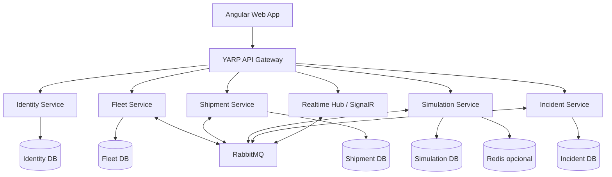

# 3. Arquitectura

## 3.1 Estilo

Microservicios orientados a capacidades de negocio, con un número deliberadamente limitado de servicios. No se busca dividir cada módulo CRUD en un servicio independiente.

## 3.2 Vista lógica

> Editable source: [`architecture-overview.mmd`](../assets/architecture/architecture-overview.mmd). The SVG is the rendered overview for GitHub; update both files when the architecture changes.

El diagrama es conceptual. La ubicación final de SignalR y notificaciones se definirá durante el diseño detallado; no es obligatorio que cada capacidad sea un despliegue independiente.

## 3.3 Responsabilidades

- **Angular:** presentación, navegación, validación de experiencia y consumo de APIs/hub.
- **YARP Gateway:** enrutamiento, políticas transversales apropiadas y punto de entrada; no contiene lógica de negocio.
- **Identity:** autenticación, usuarios, roles y emisión/validación de tokens.
- **Fleet:** vehículos, conductores, centros y disponibilidad.
- **Shipment:** clientes, envíos, asignaciones e historial de estados.
- **Simulation:** reloj de simulación, progreso de vehículos, escenarios y eventos de simulación.
- **Incident:** ciclo de vida y seguimiento de incidentes.
- **Realtime:** distribuye actualizaciones a clientes conectados; puede integrarse inicialmente con Simulation/Incident si no justifica servicio independiente.

## 3.4 Comunicación

- HTTP/REST para consultas y operaciones que requieren respuesta inmediata.
- RabbitMQ para eventos de dominio y trabajo asíncrono.
- SignalR para notificar al navegador sobre cambios relevantes.
- Redis opcional para estado efímero, coordinación o caché; no será fuente de verdad.

## 3.5 Consistencia

Cada servicio es dueño de sus datos. Los procesos que cruzan límites se coordinan mediante eventos y consistencia eventual. Evitar transacciones distribuidas. Para eventos que no deben perderse, evaluar Transactional Outbox y consumidores idempotentes.

## 3.6 Resiliencia

- Timeouts explícitos en llamadas HTTP.
- Reintentos solo para fallos transitorios y operaciones seguras.
- Circuit breaker cuando el patrón y la dependencia lo justifiquen.
- Dead-letter queue para mensajes que excedan reintentos.
- CorrelationId/TraceId en logs y mensajes.
- Degradación elegante ante caída de OSRM o Redis.

## 3.7 Escalabilidad

La simulación puede escalar horizontalmente si el diseño de ejecución evita que dos instancias procesen la misma simulación. Esto requiere estrategia de ownership/lease o partición por SimulationId. No escalar antes de medir.
